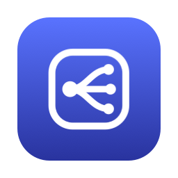
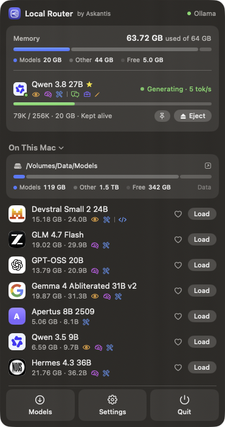
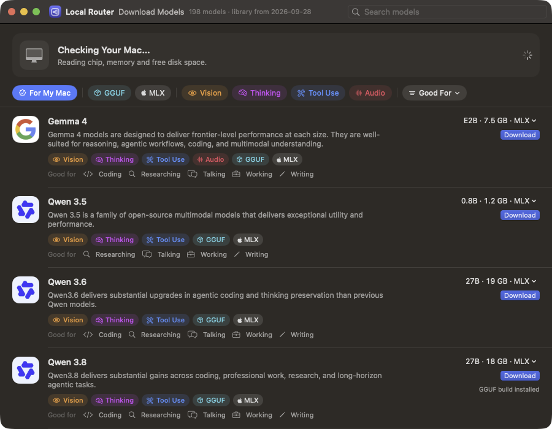
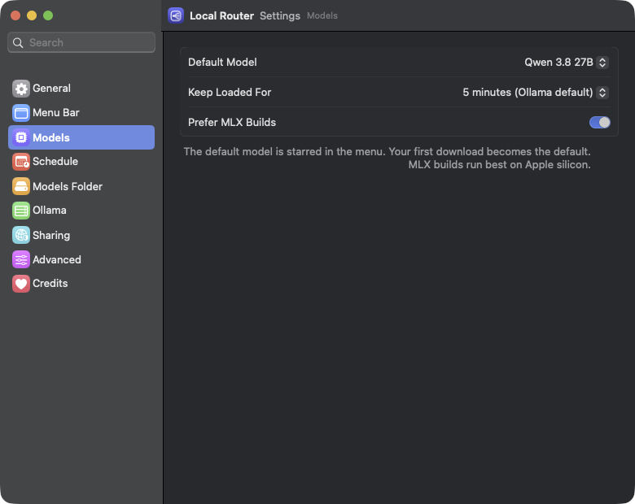
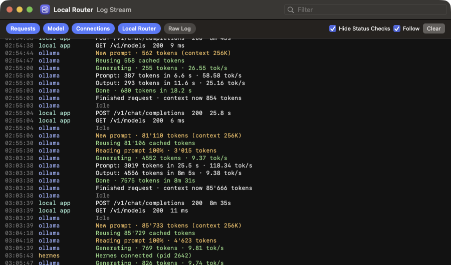

<div align="center">



# Local Router

**Your local AI models, one click away in the menu bar.**

See what Ollama has loaded, load and eject models, watch memory and context fill live,<br>
and download the models that actually fit your Mac.

[](https://github.com/Askantis/public-local-router/releases/latest/download/Local-Router.dmg)

[](https://github.com/Askantis/public-local-router/releases/latest)
[](https://github.com/Askantis/public-local-router/releases)


[](https://ollama.com)
[](LICENSE)


<br>



</div>

---

## Why

Ollama is great at downloading and running models, and it has no window to show you what's going on. Which models are in memory? How full is the context? Is the model reading your 40K-token prompt or already answering? Will that 27B model even fit?

Local Router answers those at a glance, from the menu bar, and leaves Ollama in charge of everything else. Keep using `ollama` in the terminal as before; Local Router just watches and helps.

> [!IMPORTANT]
> **Local Router collects nothing.** No accounts, no analytics, no crash reports, no telemetry. It talks to Ollama on your Mac and never reads or stores your prompts. See [PRIVACY.md](PRIVACY.md).

## Features

|  |  |
|---|---|
| **Load and Eject** | One click to load a model before you need it, or eject it to free memory. Pin a model with **Keep Alive** so it stays loaded until you eject it. |
| **Live memory** | The whole Mac's memory, split into loaded models, other apps and free. While a model loads, the bar shows its progress. |
| **Context fill** | How much of each model's context window is in use (`29K / 256K`), with a bar that turns yellow and red as it fills. |
| **What the model is doing** | *Reading prompt 34%* or *Generating · 18 tok/s*, with an orange or pink dot on the menu bar icon while it works. |
| **Download models that fit** | Scans your chip, memory and disk, then recommends Ollama library models that run well, largest good size first. Filter by format (GGUF, MLX), capability (vision, thinking, tool use, audio), use and size. |
| **MLX on Apple silicon** | Prefers MLX builds on Apple silicon Macs, falling back to GGUF where there's none. |
| **Default model** | Star one model as your default and have it loaded, with Ollama started, when you log in. Keep loading another one instead, and Local Router offers to make that the default. |
| **Your menu bar, your numbers** | Show the model's memory, context used and uptime next to the icon, like `13 GB \| 24% \| 1h`, or just the icon. |
| **Ollama's settings, finally in one place** | Default context length, memory saver (KV cache), flash attention, models loaded at once, parallel requests, idle unload and network access, with a clear "restart to apply". Local Router sets them again at every login, since macOS forgets them. Per-model context lengths live in each model's settings. |
| **Share securely** | Let other devices use your models through Local Router, with an access key per device and HTTPS encryption. Ollama itself stays private. Works like any OpenAI-compatible provider: base URL plus API key. |
| **Log Stream** | A terminal-style view of what Ollama is doing: requests and the app they came from (for example Hermes), each new prompt and how much came from the cache, prompt progress, generation speed and a summary per request. |
| **Organise** | Short, readable names with the maker's logo (`glm-4.7-flash:latest` → *GLM 4.7 Flash*), your own names, tags (Coding, Researching, Talking, Working, Writing) and Favorites. |
| **Models folder** | See where models live and how full the drive is, and move them to another folder or an external drive with a checked copy. |
| **Delete** | Remove models you don't use, with the space it frees shown before you confirm. |
| **Onboarding** | Checks that Ollama is installed and running, sets up the models folder, and asks for the two optional permissions. |

<table>
  <tr>
    <td width="55%"></td>
    <td></td>
  </tr>
  <tr>
    <td colspan="2"></td>
  </tr>
</table>

## Install

**Requirements:** macOS 15 Sequoia or later and [Ollama](https://ollama.com/download). Apple silicon is recommended; MLX needs it.

### Download

Get **[Local-Router.dmg](https://github.com/Askantis/public-local-router/releases/latest/download/Local-Router.dmg)** from the [latest release](https://github.com/Askantis/public-local-router/releases/latest), open it and drag **Local Router** into Applications. The app is signed and notarized by Apple, so it opens like any other app.


### Build from source

```bash
git clone https://github.com/Askantis/public-local-router.git
cd public-local-router
scripts/build-app.sh
open "build/Local Router.app"
```

You need Xcode 16 or later (Swift 6). The build script makes a signed-for-this-Mac app in `build/`.

## Using it

1. **Start it.** Local Router lives in the menu bar; there's no Dock icon. The first launch walks you through setup.
2. **Load a model.** Click the icon, then **Load** next to a model. It moves into the Memory card while it loads.
3. **Keep it warm.** Press the pin to **Keep Alive**, or set how long loaded models stay in memory under **Settings**.
4. **Watch it work.** When an app sends the model a prompt, the menu shows whether it's reading or generating, how fast, and how full the context is. The menu bar icon shows the context fill in percent.
5. **Find more models.** The **Models** button lists what runs well on your Mac. Pick a size and press **Download**.
6. **Quit when you like.** Ollama keeps running, and keeps your models loaded, after Local Router quits. **Quit** tells you what's still running and can eject everything first.

Hover over a model and use **⋯** to rename it, tag it, add it to Favorites or delete it.

Links you can use from Shortcuts, Raycast or the terminal:

| Link | Opens |
|---|---|
| `localrouter://library` | Download Models |
| `localrouter://settings` | Settings |
| `localrouter://advanced` | Ollama's server settings |
| `localrouter://logs` | Log Stream |
| `localrouter://storage` | Models folder |
| `localrouter://welcome` | The welcome guide |

## How it works

Local Router is a small native SwiftUI app. It talks to the Ollama that's already on your Mac and doesn't run models itself.

- **Ollama's API** (`localhost:11434`) for installed and loaded models, loading (`keep_alive`), ejecting, downloading and deleting.
- **llama.cpp's `/slots`** for context fill and activity. Ollama runs each GGUF model in its own `llama-server`, and Local Router reads its status. MLX models don't use llama-server, so they only show their context size.
- **macOS memory statistics**, the same numbers Activity Monitor uses.
- **A bundled model catalog** built from the Ollama library, with makers' icons from Hugging Face. `scripts/update-catalog.py` refreshes it.
- **The models folder** is changed by linking `~/.ollama/models` to the folder you choose, which works for the Ollama app, Homebrew and `ollama serve` alike.

### Privacy

Everything stays on your Mac. Local Router has no accounts, analytics or telemetry, and it never stores your prompts: it only reads token counts. It connects only to Ollama on `localhost`, and downloads go through Ollama.

Sharing is off by default. When you turn on **Share with Access Keys**, Local Router listens on your network (port 11435), accepts only requests with a valid key (`Authorization: Bearer lr_…`), removes the key and passes the request to Ollama. Keys are shown once and stored only as SHA-256 fingerprints. With HTTPS on, traffic is encrypted with a certificate made on your Mac; other devices need to trust it.

## FAQ

<details>
<summary><b>Is the load progress exact?</b></summary>

No. Ollama doesn't report load progress. Local Router estimates it from the model's size and remembers how long each model took last time, so it gets more accurate. It never shows 100% before Ollama confirms the model is loaded.
</details>

<details>
<summary><b>Why can't it tell thinking from answering, or show tool calls?</b></summary>

Those are in the model's output, which goes straight from Ollama to your app. Local Router only sees token counts. A local endpoint that your apps talk to instead is next on the [roadmap](docs/ROADMAP.md), and it will show thinking, tool use and images.
</details>

<details>
<summary><b>Should I use MLX or GGUF?</b></summary>

On Apple silicon, MLX is Apple's own framework and usually the better fit, which is why it's preferred by default. MLX builds are often a bit larger, and their memory grows with the conversation. Turn off **Prefer MLX** in Settings to get GGUF suggestions instead.
</details>

<details>
<summary><b>Is moving the models folder safe?</b></summary>

Across drives, Local Router copies every file, checks its size, and only then deletes the originals. A folder that still has content is renamed, never deleted. Ollama is stopped during the move and started again afterwards. If `OLLAMA_MODELS` is set, it overrides the folder, so Local Router tells you instead of moving anything.
</details>

<details>
<summary><b>Does it work without Ollama?</b></summary>

No. Ollama downloads and runs the models. Local Router is a companion for it.
</details>

## Roadmap

Local Router is heading towards being a local, private router in the spirit of OpenRouter: one endpoint on your Mac that sends each request to the right local model. See [docs/ROADMAP.md](docs/ROADMAP.md).

The next step is a background service that other apps connect to with one click, for language models and for speech. Its protocol is drafted in [spec/](spec/README.md).

## Contributing

Issues and pull requests are welcome. For bigger changes, open an issue first so we can talk it through. Releases are built by GitHub Actions; see [docs/RELEASING.md](docs/RELEASING.md).

## Credits

- Made by [Mikel Prandini](https://www.linkedin.com/in/mikel-prandini) ([MikiTheAlien](https://github.com/MikiTheAlien)), published by [Askantis](https://askantis.ch).
- [Ollama](https://ollama.com), which does the real work, and [llama.cpp](https://github.com/ggml-org/llama.cpp), whose server status Local Router reads.
- Model makers' logos come from their [Hugging Face](https://huggingface.co) organisations and belong to their owners.
- Model descriptions come from the [Ollama library](https://ollama.com/library).

## License

Local Router is **free for noncommercial use** under the [PolyForm Noncommercial License 1.0.0](LICENSE): personal use, research, education, nonprofits and trying it out at work are all fine. You can share it and changed versions, as long as you keep the credit (the "Required Notice" lines in [LICENSE](LICENSE)). For commercial use, [contact Askantis](https://askantis.ch).

© 2026 Mikel Prandini ([MikiTheAlien](https://github.com/MikiTheAlien)) · Published by [Askantis](https://askantis.ch)

<div align="center">
<br>
<sub>Made by <a href="https://github.com/MikiTheAlien">MikiTheAlien</a> · Published by <a href="https://askantis.ch">Askantis</a> · Collects nothing</sub>
</div>
